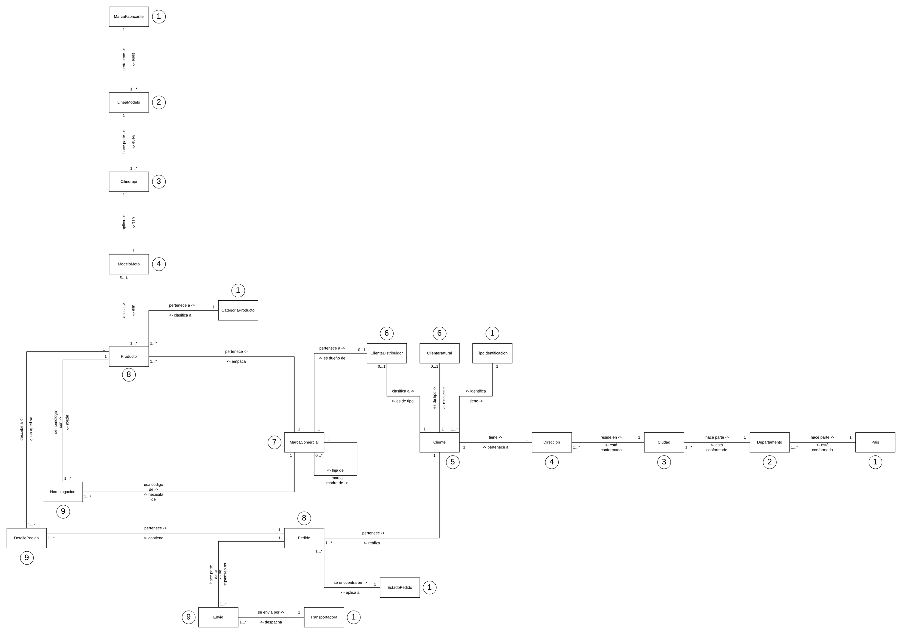
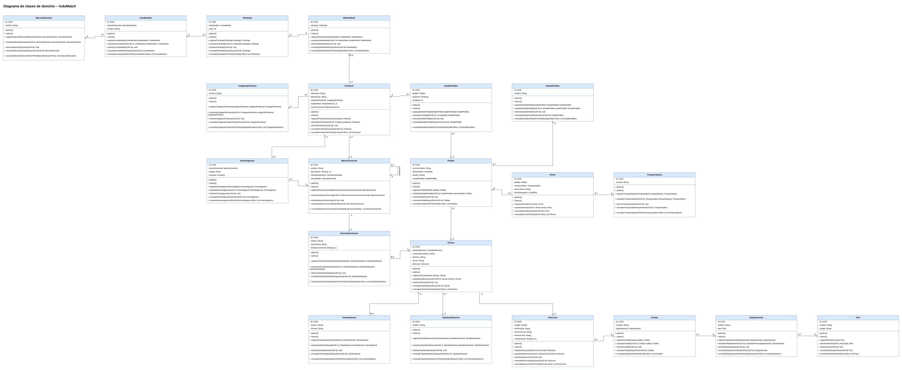
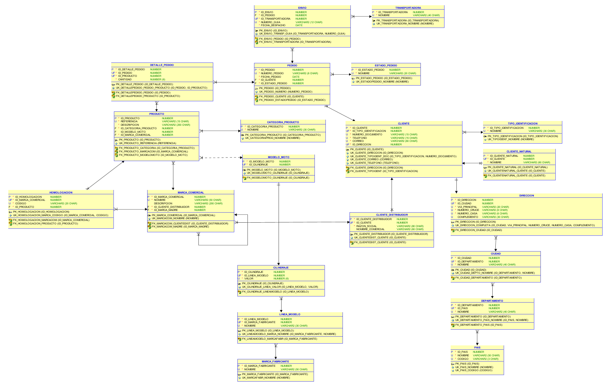

# InduMatch

Sistema de gestión de pedidos para **Indusel**. Este proyecto implementa la transacción **Registrar cliente**.

## Problema

En Indusel se pierde mucho tiempo al registrar los pedidos: cada cliente pide los productos con sus propios códigos y referencias, y hay que buscar manualmente a qué producto de Indusel corresponde cada uno.

Por eso se pensó la **homologación**: relacionar el código que maneja cada marca comercial con el producto de Indusel, para que los pedidos se puedan identificar y registrar rápidamente.

## Tecnologías

Java 26 · Spring Boot 4.1.1 · Thymeleaf · Bootstrap 5.3 · PostgreSQL · Maven · SonarCloud

## Diseño

### Modelo de dominio

Objetos del negocio y sus relaciones. El número junto a cada objeto es su nivel de dependencia.



### Diagrama de clases



### Modelo relacional

Tablas de la base de datos con sus llaves primarias, foráneas y restricciones de unicidad.



## Arquitectura

El proyecto sigue la arquitectura por capas vista en clase:

```
Controlador → Fachada → Negocio → Reglas → DAO → Base de datos
```

- **Controlador:** recibe la petición. Hay uno para la página web (`ClienteVistaControlador`) y otro para el API REST (`ClienteControlador`). Los dos usan la misma fachada.
- **Fachada:** maneja la transacción. Si todo sale bien confirma; si algo falla, deshace.
- **Negocio:** ejecuta las reglas en orden y registra el cliente.
- **Reglas:** cada política de negocio es una clase.
- **DAO:** guarda y consulta en PostgreSQL.
- **Transversal:** utilitarios, mensajes (`CatalogoMensajes`) y excepciones.

## Transacción: Registrar cliente

Se registra el cliente junto con su dirección. Si algo falla, no se guarda nada.

**Reglas que se validan:**

- CLI-P-0001: los datos del cliente tienen el formato correcto.
- CLI-P-0003: el tipo de identificación existe.
- CLI-P-0004: no hay otro cliente con el mismo tipo y número de documento.
- CLI-P-0005: no hay otro cliente con el mismo correo.
- CLI-P-0006: no hay otro cliente con el mismo teléfono.
- DIR-P-0001: los datos de la dirección tienen el formato correcto.
- DIR-P-0004: la ciudad existe.
- DIR-P-0005: no hay otra dirección igual registrada.

Las validaciones de formato se hacen en el **front** (atributos HTML del formulario) y también en el **back**.

## Rutas

| Ruta | Descripción |
|---|---|
| `GET /` | Formulario para registrar un cliente |
| `POST /api/v1/clientes` | Registrar un cliente (API) |
| `GET /api/v1/tipos-identificacion` | Consultar los tipos de identificación |
| `GET /api/v1/ciudades` | Consultar las ciudades |

## Cómo ejecutarlo

1. Crear en PostgreSQL la base de datos `indumatch` y ejecutar el script `basedatos/InduMatch_PostgreSQL.sql`.
2. Definir la variable de entorno `INDUMATCH_BD_CLAVE` con la contraseña de PostgreSQL.
3. Ejecutar `InduMatchBackEndApplication` desde Eclipse.
4. Abrir **http://localhost:8080/**.

## Autor

Tomás
